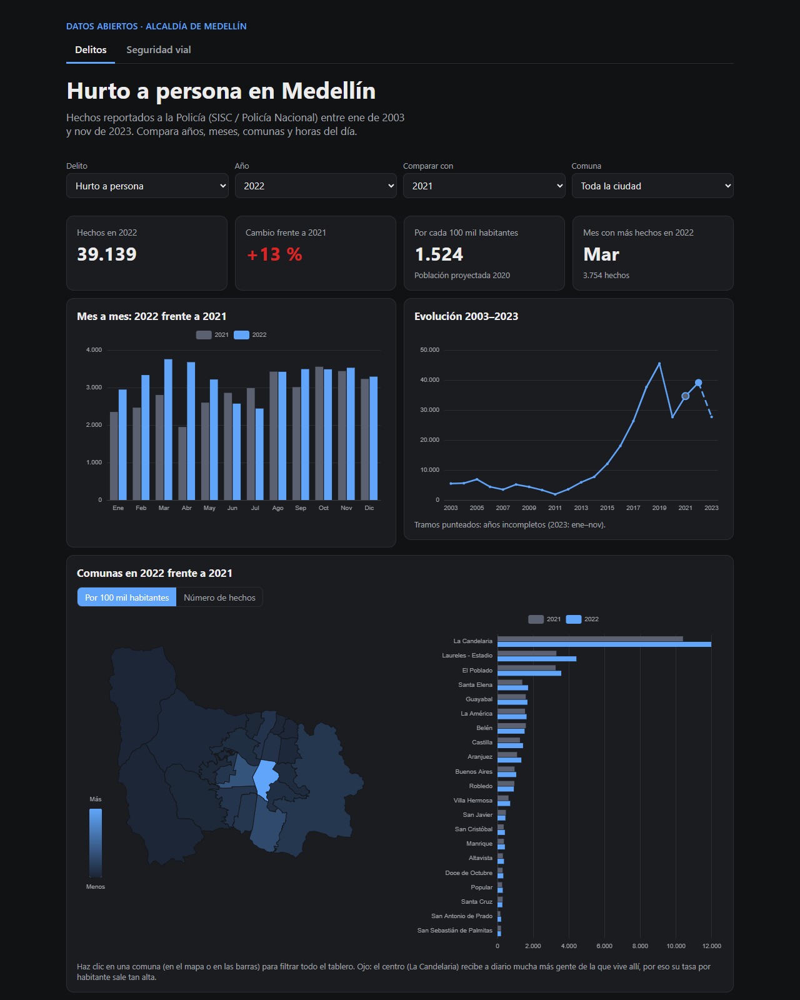
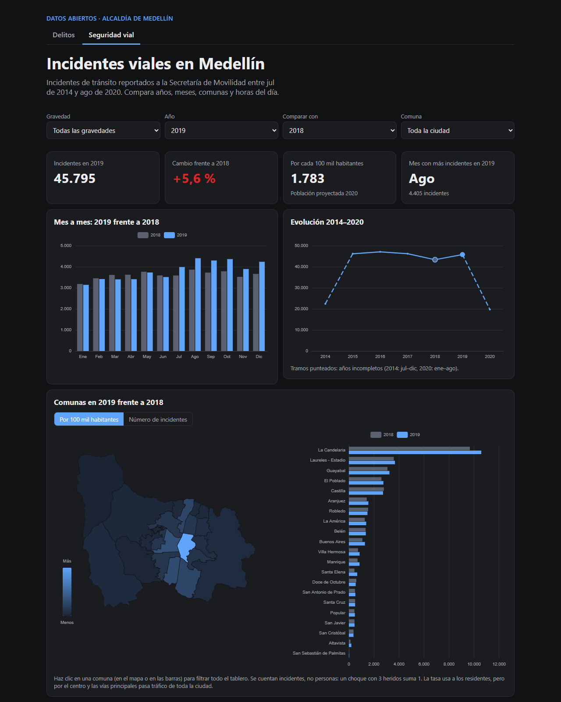
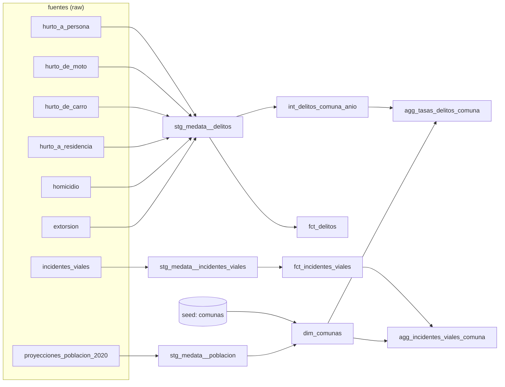

# Seguridad en Medellín — proyecto dbt

[](https://github.com/luismiguelro/medellin-seguridad-dbt/actions/workflows/ci.yml)
[](https://github.com/luismiguelro/medellin-seguridad-dbt/actions/workflows/deploy.yml)

📊 **Tablero:** https://luismiguelro.github.io/medellin-seguridad-dbt/ · 📖 **Documentación y linaje:** https://luismiguelro.github.io/medellin-seguridad-dbt/docs/

Pipeline analítico sobre **datos abiertos de seguridad ciudadana y seguridad vial de Medellín**
(MEData, Alcaldía de Medellín), construido con **dbt + DuckDB** siguiendo las prácticas del curso
*dbt Fundamentals* de dbt Labs.

## Tablero

Para público no técnico: filtros por delito o gravedad, año, año de comparación y comuna; mes a mes,
evolución anual, mapa y ranking de comunas (por número de hechos o por 100 mil habitantes) y mapa
de calor por día y hora. Dos pestañas: **Delitos** (2003–2023) y **Seguridad vial** (2014–2020).



<details>
<summary>Pestaña Seguridad vial</summary>



</details>

**Cómo funciona, sin servidor:** el job de deploy exporta a Parquet los marts que declara la
*exposure* `tablero_seguridad_medellin` (~530 KB en total) y el sitio en React los consulta con
**DuckDB-WASM**, el mismo motor de dbt corriendo dentro del navegador. Cada filtro es una consulta SQL
local. Código en [`web/`](web/); exportación en [`scripts/exportar_marts.py`](scripts/exportar_marts.py).

## Preguntas de negocio

- ¿Cómo ha evolucionado cada delito (hurtos, homicidios, extorsión) entre 2003 y 2023?
- ¿Qué comunas y barrios concentran más hechos, en número absoluto y **por cada 100 mil habitantes**?
- ¿A qué horas y días ocurren los hurtos? ¿Con qué modalidad y arma?
- ¿Dónde se concentran los incidentes viales con heridos o muertos?

## Fuentes

| Tabla `raw` | Dataset MEData | Filas |
|---|---|---|
| `hurto_a_persona` | Hurto a persona | 326 489 |
| `hurto_de_moto` | Hurto de moto | 86 410 |
| `hurto_de_carro` | Hurto de carro | 39 571 |
| `hurto_a_residencia` | Hurto a residencia | 42 673 |
| `homicidio` | Homicidio | 19 647 |
| `extorsion` | Extorsión | 6 540 |
| `incidentes_viales` | Incidentes viales (2014–2020) | 270 765 |
| `proyecciones_poblacion_2020` | Proyecciones de población por comuna | 432 |

Los delitos provienen del SISC / Policía Nacional y comparten el mismo esquema (un registro por hecho,
con coordenadas, barrio y comuna). El dataset "Hurto a personas en transporte público" no se carga
porque es un subconjunto exacto de "Hurto a persona".

## Arquitectura

```
MEData (CSV) ──► ingest/extract_load.py ──► DuckDB: raw.*
                                               │
                                     dbt  ┌────┴─────┐
                                          ▼          ▼
                                      staging   (limpieza, tipos)
                                          ▼
                                     intermediate (uniones, lógica)
                                          ▼
                                        marts  (hechos y dimensiones)
                                          ▼
                        exposure ──► Parquet ──► tablero React + DuckDB-WASM (GitHub Pages)
```

### Linaje (DAG de dbt)



El grafo interactivo (con columnas, tests y descripciones) está en la
[documentación publicada](https://luismiguelro.github.io/medellin-seguridad-dbt/docs/).

## Cómo ejecutarlo

```bash
python -m venv .venv
.venv/Scripts/activate          # Windows  (Linux/Mac: source .venv/bin/activate)
pip install -r requirements.txt

python ingest/extract_load.py   # descarga ~280 MB y carga raw.* en data/medellin.duckdb
dbt debug                       # usa el profiles.yml del proyecto
dbt build
```

## Deployment (CI/CD con GitHub Actions)

| Entorno (`target`) | Esquemas | Cuándo se construye |
|---|---|---|
| `dev` | `dev_*` | a mano, en local (`dbt build`) |
| `ci` | `ci_*` | en cada pull request ([`ci.yml`](.github/workflows/ci.yml)) |
| `prod` | `prod_*` | cada lunes 6 a. m. (COT), en cada push a `main` o a mano ([`deploy.yml`](.github/workflows/deploy.yml)) |

El job de producción ejecuta ingesta → `dbt source freshness` → `dbt build` → `dbt docs generate`
→ exportación de marts → build del tablero, y publica tablero y documentación en GitHub Pages.
Además, [`revisar_medata.yml`](.github/workflows/revisar_medata.yml) consulta a diario el ETag de cada
archivo de MEData (sin descargarlos) y dispara el deploy solo si la Alcaldía publicó cambios. Un PR con un test roto queda en ❌ y no llega a prod.

## Hallazgos

- **Homicidios a la baja:** de 2 095 en 2009 a 544 en 2016 y 343 en 2023 (hechos con comuna registrada).
- **Hurto a persona concentrado en el centro:** en 2022 La Candelaria registra ~11 976 hurtos por cada
  100 mil habitantes, casi 3 veces Laureles-Estadio (4 420) y El Poblado (3 572).
- **Cómo y cuándo:** el atraco es la modalidad más común (163 052 hechos), seguido del descuido (60 264);
  la tarde es la franja con más hurtos y la madrugada la de menos.
- **Seguridad vial:** La Candelaria también encabeza los incidentes viales con muertos (306 entre 2014 y 2020),
  seguida de Castilla (154) y Laureles-Estadio (116).

## Limitaciones de los datos

- **Tasas con denominador fijo:** todas las tasas usan la población proyectada de 2020; para años lejanos
  son aproximadas.
- **Población flotante:** comunas como La Candelaria reciben a diario mucha más gente de la que vive allí,
  así que su tasa por residente sobreestima el riesgo real por persona.
- **Delitos sin comuna:** ~1,8 % de los hechos no traen comuna y quedan fuera de los agregados.
- **Incidentes viales:** 23 radicados duplicados con datos distintos y 5 incidentes fatales sin radicado
  (se conservan y se reportan como advertencias de test, no se borran); 6 incidentes sin hora registrada.
- **Cobertura temporal distinta:** delitos 2003 – nov 2023, incidentes viales jul 2014 – ago 2020.
- **Coordenadas:** ~195 hechos con coordenadas fuera de Medellín (test de advertencia).

## Estado

- [x] Módulo 1 — Setup del proyecto y carga de datos crudos
- [x] Módulo 2 — Models (staging, marts, `ref`)
- [x] Módulo 3 — Sources (`source`, freshness)
- [x] Módulo 4 — Tests (genéricos y singulares)
- [x] Módulo 5 — Documentación (`dbt docs`)
- [x] Módulo 6 — Deployment (entornos, jobs y CI con GitHub Actions)

Después del curso:

- [x] Fase A — Detección diaria de cambios en MEData y freshness por fecha del último hecho
- [x] Fase B — Tablero web (React + DuckDB-WASM): delitos y seguridad vial, mapa de comunas, CI del frontend
